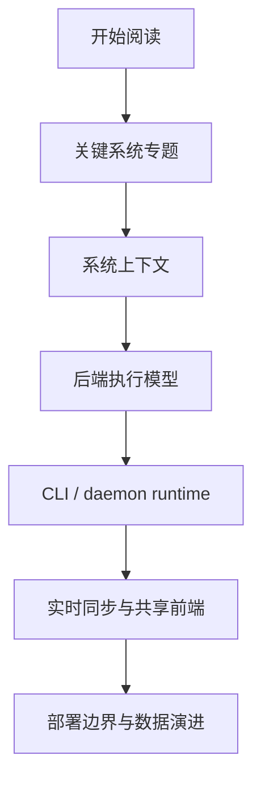

# ai-docs

`ai-docs` 是面向工程接手和 AI agent 阅读的 Multica 技术导读区。它不替代根目录 README、产品文档或正式 docs 站点，而是把仓库里高信号的代码面整理成专题说明，便于快速建立系统心智模型。

## 文档包

| 文档包 | 适合什么时候读 | 入口 |
| --- | --- | --- |
| Multica 关键系统专题 | 想先判断 Multica 最关键的复杂度中心，并按 workspace、agent 执行、实时同步、多端共享、自动化扩展拆开理解 | [`multica-key-systems/README.md`](multica-key-systems/README.md) |
| 系统运行面与执行模型 | 想从仓库结构、server 常驻机制、CLI/daemon、自托管边界、数据演进信号理解系统骨架 | [`multica-system-surfaces-and-execution-model/README.md`](multica-system-surfaces-and-execution-model/README.md) |
| 系统运行面架构版 | 想按架构导读顺序阅读系统上下文、server 执行模型和 schema 演进信号 | [`multica-system-surfaces-and-execution-model-arch/README.md`](multica-system-surfaces-and-execution-model-arch/README.md) |

## 推荐入口

如果你是第一次接手 Multica，建议按这个顺序：

1. 先读 `multica-key-systems/README.md`，确认哪些主题最关键。
2. 再读 `multica-key-systems/01-critical-map.md`，建立整体复杂度地图。
3. 如果要改后端或执行链路，继续读已有 `multica-system-surfaces-and-execution-model*` 文档包。
4. 如果要改前端共享逻辑，优先读 `multica-key-systems/04-realtime-query-cache-sync.md` 和 `05-shared-frontend-platform.md`。

## 维护原则

- 每组文档应有自己的 `README.md`。
- 主题文档应尽量引用具体代码路径，而不是只写抽象判断。
- 涉及流程、边界、状态机时优先使用 Mermaid 图表。
- 新增文档后应验证 Markdown fence、相对链接和关键代码引用。
