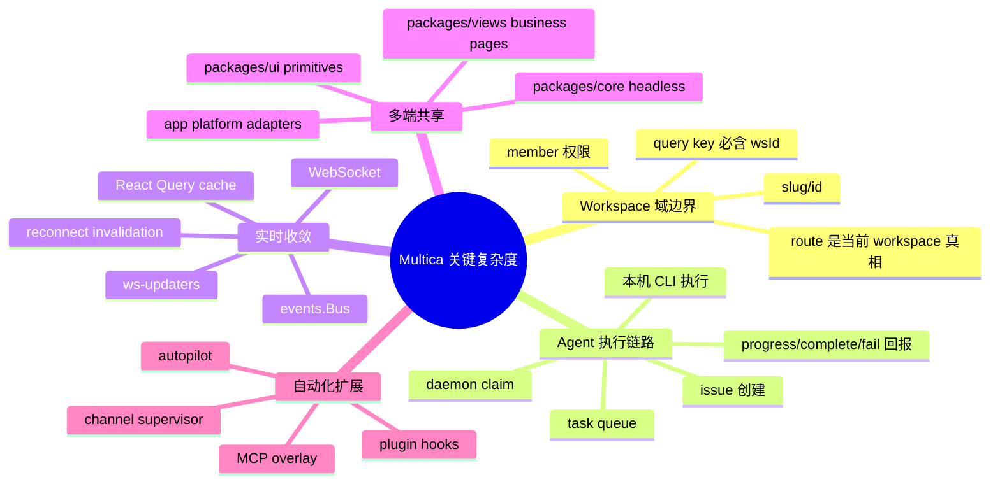
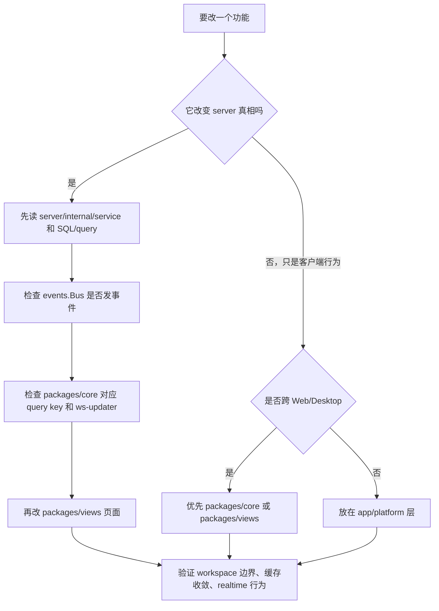

# 关键地图：我认为 Multica 最关键的五块内容

先给结论：**Multica 最关键的不是“AI 聊天”或“任务列表”，而是把团队协作对象、真实本机 agent 执行、实时状态收敛、多端复用和自动化扩展粘成一个可靠闭环。**

从仓库证据看，最值得优先理解的是五块：

1. **Workspace 域模型**：所有 issue、member、agent、runtime、inbox、billing、integration 都必须被 workspace 边界约束。
2. **Issue → Task → Runtime 执行链路**：用户像派同事一样派 issue，后端把它变成可 claim 的 agent task，daemon 在用户机器上执行并回报。
3. **Realtime + Query cache 收敛层**：客户端默认 `staleTime: Infinity`，因此 WebSocket 事件和显式 invalidation 是前端“保持真相”的关键机制。
4. **共享前端与平台适配层**：Web、Desktop 共享 `packages/core/ui/views`，但路由、存储、通知、Electron 能力必须留在平台层。
5. **Automation / Integration 扩展面**：Autopilot、channel、plugin、MCP 把外部事件和自动规则接进同一套 issue/task 运行模型。

## 为什么这五块优先级最高

### 1. Workspace 是所有状态的租户边界

`CLAUDE.md` 反复强调 workspace-scoped query key 必须包含 `wsId`，workspace identity 由路由驱动；`apps/web/app/[workspaceSlug]/layout.tsx` 又把 URL slug 解析成 workspace，并在 render 阶段调用 `setCurrentWorkspace(workspaceSlug, workspace.id)`，给 API header 和 WS 连接使用。这说明 workspace 不是页面参数，而是前端、API、WS、权限和缓存共同依赖的边界。

### 2. Agent 执行链路是产品差异化

`server/internal/service/issue.go` 明确把 issue create 做成 transport-agnostic service，让 HTTP、Lark 等入口共享 duplicate guard、编号、附件、广播、analytics、agent/squad enqueue。`server/internal/service/task.go` 再把队列、runtime freshness、claim recovery、MCP overlay、quick actions 等装在 `TaskService`。这条链路说明 Multica 的核心不是“记录任务”，而是“把任务交给 agent 并追踪执行”。

### 3. 前端真相依赖 Query cache 和 WS

`packages/core/query-client.ts` 把 query `staleTime` 设为 `Infinity`。这会让界面非常稳定，也意味着**没有事件或 invalidation，就不会自动重新取数**。因此 `packages/core/realtime/use-realtime-sync.ts`、各域 `queries.ts`、`ws-updaters.ts` 是关键系统层，而不是普通 UI 辅助代码。

### 4. 多端复用靠边界，不靠复制

`CLAUDE.md` 的 package boundary 很硬：`core` 无 `react-dom/localStorage/process.env`，`ui` 不 import `@multica/core`，`views` 不 import `next/*` 或 `react-router-dom`。`packages/views/navigation` 定义 `NavigationAdapter`，Web 在 `apps/web/platform/navigation.tsx` 接 Next router，Desktop 在 renderer/platform 接 Electron/react-router 行为。这种边界保证同一业务页面能跑在 Web/Desktop，而不是维护两套逻辑。

### 5. 自动化和集成不是外围功能

`server/cmd/server/router.go` 把普通 API、WS、daemon API、webhook/channel route、channel supervisor 组装在同一个 server 进程；`server/internal/service/autopilot.go` 把 scheduled/webhook/manual autopilot 都归入 issue/task side effect；plugin 相关 service 和 migration 又把 hook、MCP、invocation、token 变成正式数据面。这说明 Multica 的扩展能力最终仍落回核心 issue/task 模型。

## 读代码时的优先路径

这条路径比“从页面按钮一路跳”更安全，因为 Multica 很多 bug 并不发生在单次 API 调用，而发生在：另一个客户端没刷新、workspace 切换后 singleton 指错、daemon claim race、或后台 listener 没补齐派生状态。
