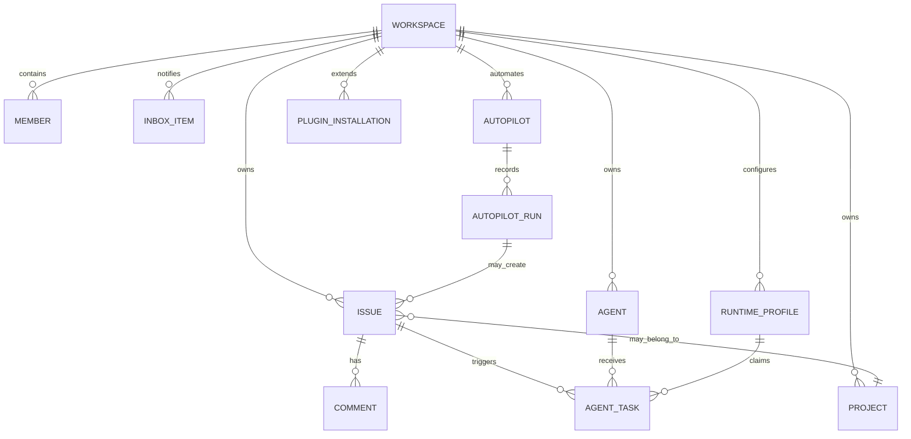
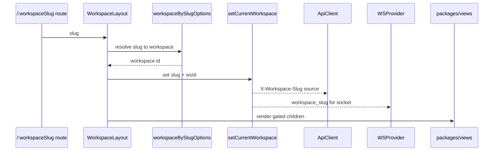
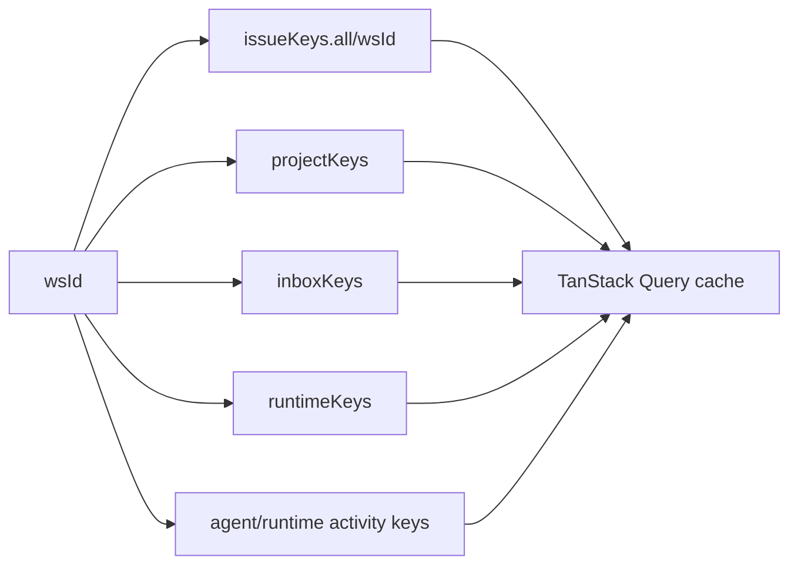

# Workspace 域模型：为什么所有关键状态都先归属于工作区

先给结论：**Workspace 是 Multica 的业务租户、URL 上下文、API header 上下文、WebSocket 连接上下文和缓存命名空间。** 读任何业务代码时，如果没有先确认当前 workspace 是谁，就很容易误解数据从哪里来、为什么刷新、以及为什么不能跨工作区复用缓存。

## 域对象关系

这不是精确 ER 图，而是工程阅读图。它表达的是：issue、agent、runtime、inbox、autopilot、plugin 这些表面上分散的对象，都必须经 workspace 边界收束。

## 前端如何建立当前 workspace

Web 的关键入口是 `apps/web/app/[workspaceSlug]/layout.tsx`：

1. 从 App Router 的 `[workspaceSlug]` 读取 slug。
2. 用 `workspaceBySlugOptions(workspaceSlug)` 从共享 workspace query 解析 workspace。
3. 在确认当前 pathname 确实属于该 slug 后调用 `setCurrentWorkspace(workspaceSlug, workspace.id)`。
4. 子树再通过 `WorkspaceSlugProvider` 暴露 slug，子 hooks 通过 `useWorkspaceId()` 获取 `wsId`。

这里最容易忽略的是 `layout.tsx` 的 pathname guard。注释说明 App Router 可能让旧 workspace layout 和新 workspace layout 同时短暂存在；如果两个 layout 都写全局 singleton，就会造成 WS 反复重连、mention lookup 读错 workspace。结论是：**URL 是 workspace identity 的源头，singleton 只是给平台 plumbing 同步使用。**

## Query key 为什么必须包含 wsId

`CLAUDE.md` 明确要求 workspace-scoped query keys 必须包含 `wsId`。`packages/core/issues/queries.ts` 的 `issueKeys.all(wsId) => ["issues", wsId]` 是典型模式，其他域也遵循同样结构。

这样做有三个目的：

- **隔离租户数据**：A workspace 的 issue list 不会被 B workspace 复用。
- **精确 invalidation**：WS 事件里拿到 `wsId` 后，可以只刷新相关 workspace。
- **支持多端和多窗口**：Web、Desktop、不同 tab 可以共享同一套 key 规则，而不需要平台层知道每个业务域的内部形状。

## 后端 service 也以 workspace 为边界

`server/internal/service/issue.go` 的 `IssueCreateParams` 从一开始就要求 `WorkspaceID`，并在 create pipeline 里验证 parent/project 属于同 workspace、做 duplicate guard、编号、附件、广播和 agent/squad enqueue。重要的是 service 不依赖 `http.Request`，而是让 HTTP、Lark、未来 MCP/API key 等入口先解析 transport，再传入已经解析的参数。

这说明 workspace 边界不是 handler 层的装饰，而是 service 层业务正确性的一部分。

## 改代码时的检查清单

- 新 query key 是否包含 `wsId`。
- hook 是否应该接受 `wsId`，而不是在不确定 provider 的地方偷偷调用 `useWorkspaceId()`。
- API request 是否依赖当前 workspace slug header。
- WS handler 是否用事件 payload 里的 workspace id 或当前 singleton 时机正确。
- 删除、离开、membership 变化时，是否需要清理 workspace-scoped storage 或 query cache。
- 桌面端是否有独立 workspace routing 协议，不能照搬 Web URL guard。

Workspace 是 Multica 的“坐标系”。坐标系错了，后面的 issue、agent、runtime、inbox 逻辑即使局部正确，也会落到错误的工作区里。
