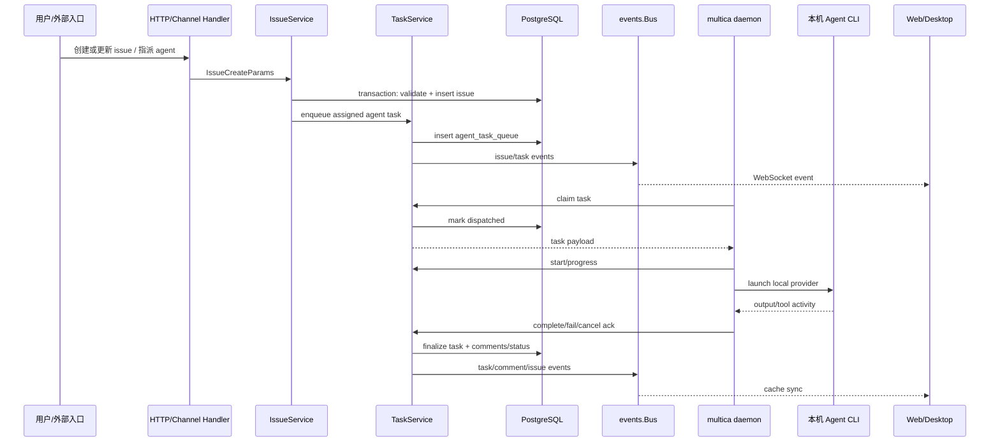
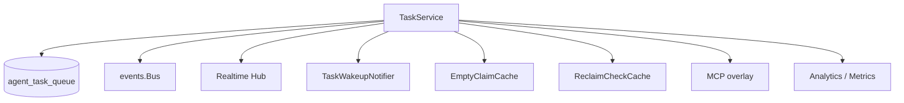
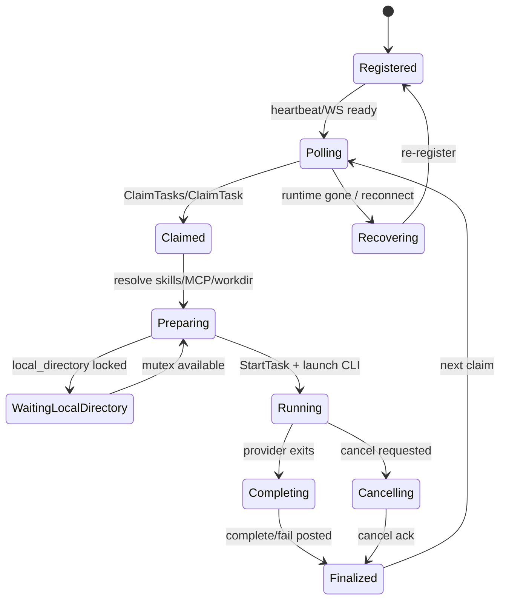

# Issue → Agent → Runtime 执行流：Multica 的核心闭环

先给结论：**Multica 的关键闭环是把协作对象 issue 转成可执行的 agent task，再由用户机器上的 daemon claim、执行、回报，最后通过事件和缓存让团队看到结果。**

这条链路是产品差异化所在：用户不是在云端黑盒里调用一个模型，而是在工作区里把任务分配给一个 agent，而 agent 的 desk 是用户自己的机器。

## 端到端流转

## IssueService 是入口收束点

`server/internal/service/issue.go` 明确写着：`IssueService` 是创建 issue 的单一 service-layer 入口。它负责让 HTTP `POST /issues`、Lark `/issue`、未来入口共享同一套逻辑：

- duplicate guard；
- issue 编号；
- parent/project workspace 校验；
- attachment linking；
- event broadcast；
- analytics；
- agent/squad enqueue。

这意味着：**不要把“创建 issue 后要不要派 agent”理解成某个页面的副作用。** 它属于 service 级业务规则，必须所有入口一致。

## TaskService 是执行协议的中枢

`server/internal/service/task.go` 的 `TaskService` 包含 DB queries、event bus、realtime hub、analytics、metrics、wakeup notifier，以及若干关键优化/安全机制：

- `EmptyClaimCache`：空队列 steady state 下避免 daemon 每次 poll 都扫 DB。
- `ReclaimCheckCache`：减少无条件 reclaim update，同时保留错误/缺失时的 DB fallback。
- `RuntimeClaimFreshnessSeconds`：约束 runtime 多久以内算 fresh，避免 stale runtime 接新活。
- `ComposioOverlayBuilder`：在 enqueue 时计算每个任务的 MCP overlay。
- Quick Actions gate：控制 chat 后续建议生成的并发。

## Daemon 是真实执行面

`server/internal/daemon/client.go` 暴露 daemon 控制面方法：`ClaimTask`、`ClaimTasks`、`StartTask`、`MarkTaskWaitingLocalDirectory`、prepare lease、skill bundle resolve、remote MCP credential 等。它还通过 `X-Client-Capabilities` 宣告 daemon 支持的协议能力，包括 skill bundles、coalesced comments、execution manifest、remote MCP、local worktree、RPC v1。

`server/internal/daemon/daemon.go` 里的状态字段说明 daemon 并不是简单 while-loop：它要处理 WS RPC、HTTP fallback、batch claim 兼容、auto-update barrier、active task 计数、runtime gone recovery、本地工作目录互斥、GC 与 store 生命周期等。

## 这条链路为什么容易出 bug

1. **claim 是分布式协议**：server、daemon、DB、WS/HTTP fallback 都可能在不同时间看到状态。
2. **执行在用户机器上**：本地目录、CLI 版本、agent path、自更新、store GC 都会影响任务。
3. **任务状态被多个视图消费**：issue timeline、agent activity、runtime health、chat quick actions、inbox 都可能需要同步。
4. **失败也要可解释**：task failure、cancel ack、oversized fallback comment、runtime unusable notice 等都不是 UI 文案，而是执行协议的一部分。

改这条链路时，最低限度要同时检查：service transaction、task queue 状态机、daemon client capability、WS event、前端 query invalidation，以及相关 race regression tests。
