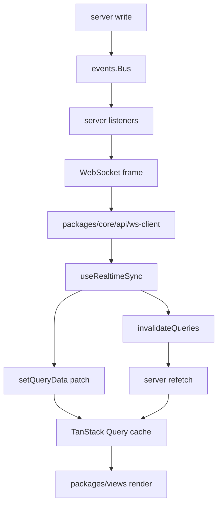
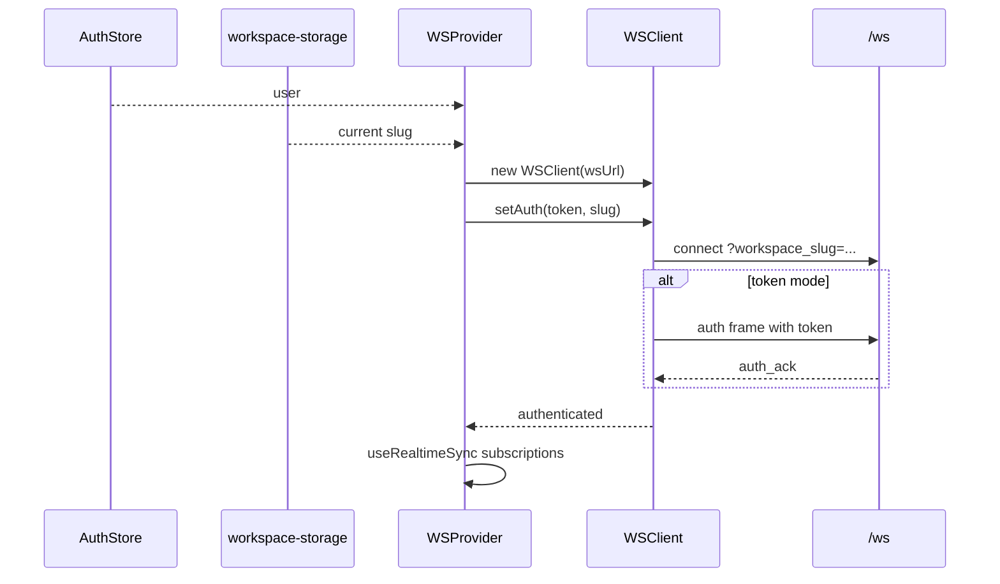
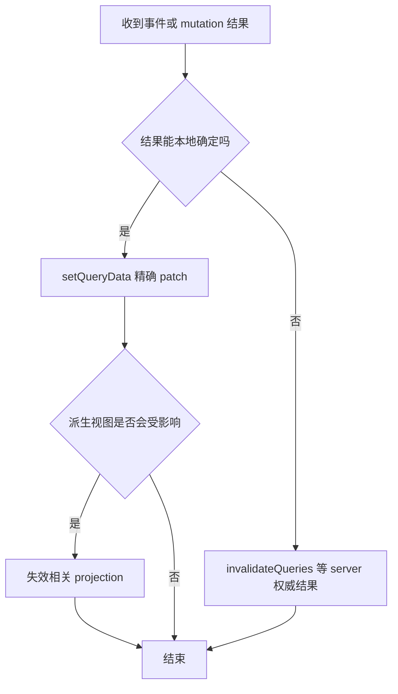

# Realtime + Query Cache：为什么前端同步层是核心架构

先给结论：**Multica 前端不是靠“页面重新加载”保持正确，而是靠 TanStack Query 保存 server state，再由 WebSocket 事件和显式 invalidation 推动缓存收敛。** 这层如果错了，用户最常见的感受是“别人改了我没看到”“agent 已经完成但界面还在跑”“切 workspace 后数据串了”。

## 基本原则

`packages/core/query-client.ts` 设置：

- `staleTime: Infinity`
- `gcTime: 10 minutes`
- `refetchOnWindowFocus: false`
- `refetchOnReconnect: true`

这意味着 query 一旦取到数据，就不会因为时间过期自动 refetch。这样能减少无意义请求，适合实时协作产品，但代价是：**所有会改变 server state 的路径，都必须配套 cache patch 或 invalidation。**

## WSProvider 如何绑定 workspace

`packages/core/realtime/provider.tsx` 从 auth store 读取 user，从 `workspace-storage` singleton 读取当前 slug；只有 user 和 slug 都存在时才创建 `WSClient`。连接参数里带 `workspace_slug`，token 模式下 token 不进 URL，而是在 socket open 后第一帧发送；cookie 模式则依赖 HttpOnly cookie。

这就是为什么 workspace singleton 的写入时机很关键：它会直接决定 WS 连到哪个 workspace。

## useRealtimeSync 是集中分发器

`packages/core/realtime/use-realtime-sync.ts` 是高信号文件。它 import 了大量 query key 和 updater：issue、project、pin、autopilot、runtime、label、property、issue status、agent activity、github/lark/slack/dingtalk/wecom/telegram、inbox、chat 等。

它的职责不是“监听消息然后 toast”，而是把 server event 映射为缓存操作：

- issue created/updated/deleted：更新 detail/list/table/children/timeline 等相关缓存。
- task lifecycle：刷新 task snapshots、agent activity、chat pending aggregate、timeline。
- inbox event：刷新 inbox 列表和跨 workspace unread summary。
- workspace/member event：刷新 workspace list，必要时清理 workspace storage。
- reconnect：补偿断线期间可能漏掉的事件。

## patch 和 invalidate 的取舍

Multica 的经验规则可以概括成：

典型例子：

- inbox new 用 invalidate，而不是 setQueryData，因为 inbox/archived split 由 server 决定。
- chat pending aggregate 只 invalidate，不从 workspace fanout task event 乐观写入，因为 payload 不带足够权限信息，必须让 server 的 permission-filtered endpoint 决定。
- issue status/assignee 这类局部、可预测变更可以做 optimistic patch，但 settle 后仍需要 invalidate 不确定 projection。

## Query key 设计本身就是架构

`packages/core/issues/queries.ts` 的 `issueKeys` 很长，不是偶然复杂。它把 list、flat、table、my issues、gantt、detail、children、timeline、trigger preview、reactions、subscribers、usage、attachments 等区分成不同 key 或 prefix，让 updater 可以有选择地 patch 或 invalidate。

要注意其中一个注释：有些 per-issue cache key 不携带 `wsId`，因此 reconnect recovery 不能只 invalidate `issueKeys.all(wsId)`，还必须显式覆盖这些全局 prefix。这个细节说明 Query key 是系统协议的一部分，不只是命名。

## 改动检查清单

- 新 server event 是否已经在 `use-realtime-sync.ts` 订阅。
- 新 query 是否有稳定 key，workspace-scoped key 是否包含 `wsId`。
- mutation 是否需要 optimistic update，是否符合 CLAUDE 的条件。
- WS payload 是否足够安全，能 patch 就 patch，不够就 invalidate。
- reconnect 后是否能恢复漏事件。
- 跨 workspace summary 是否不能只按当前 workspace 刷新。

这层的目标不是“实时看起来更快”，而是让多端、多窗口、后台 agent 和外部 webhook 共同修改同一套 server truth 时，前端最终稳定收敛。
