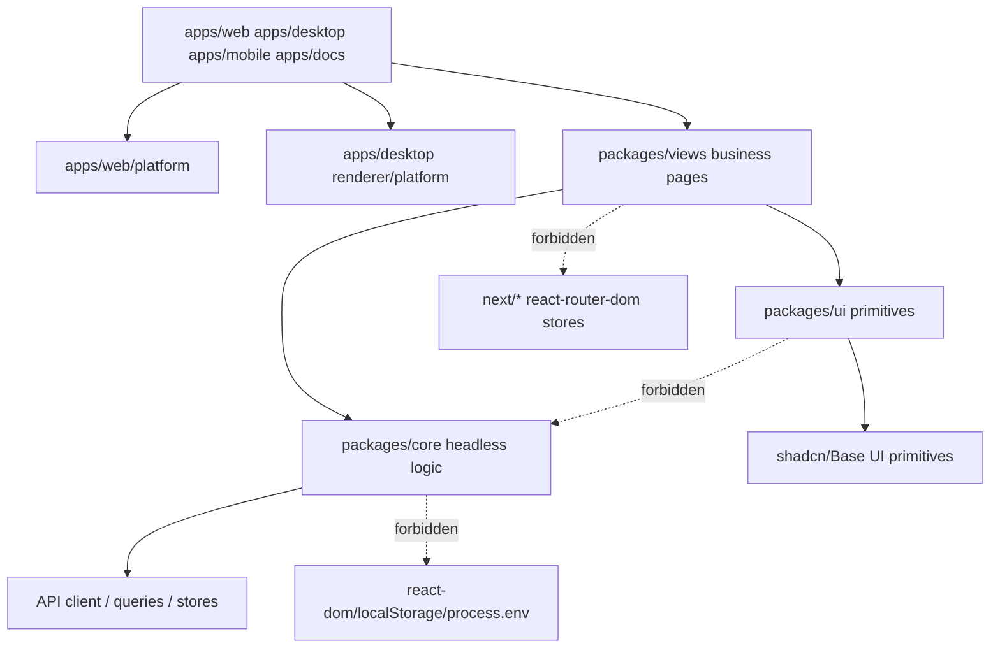
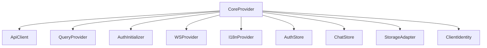
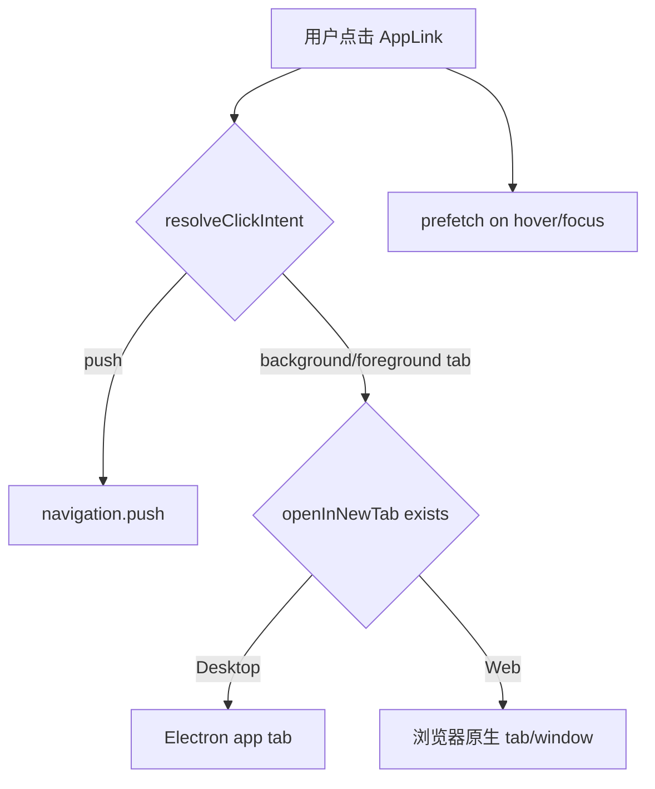
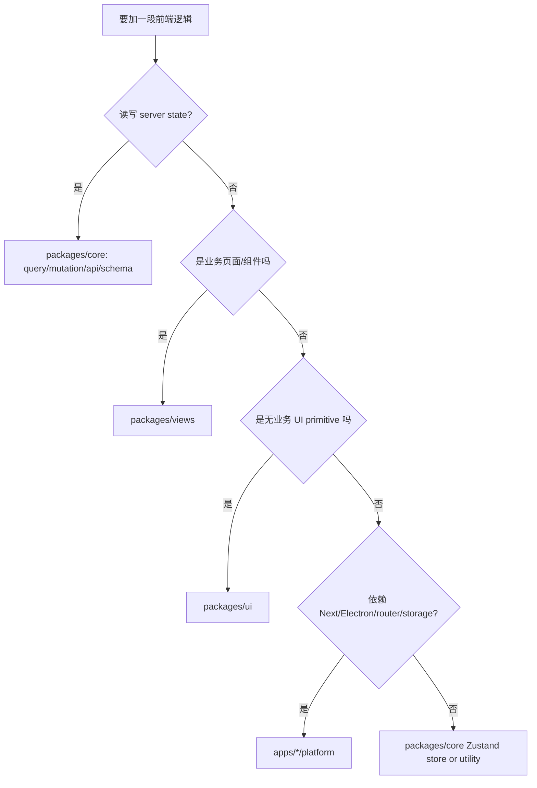

# 共享前端与平台适配：Web/Desktop 复用靠边界，不靠复制

先给结论：**Multica 前端的关键设计是把业务逻辑和页面放进共享包，把 Next.js、Electron、router、storage、通知、桌面 tab 等平台能力留在 app/platform 层。** 这使 Web 和 Desktop 能共享大部分产品体验，同时避免 `packages/views` 被具体平台污染。

## 包边界

`CLAUDE.md` 对这层有硬规则：

- `packages/core/`：headless business logic，不能依赖 `react-dom`、`localStorage`、`process.env` 或 UI library。
- `packages/ui/`：atomic components，不 import `@multica/core`，不放业务逻辑。
- `packages/views/`：共享 business pages/components，不 import `next/*` 或 `react-router-dom`，不放 Zustand stores。
- app/platform：负责把宿主平台能力注入共享层。

## CoreProvider 是共享 runtime 的根

`packages/core/platform/core-provider.tsx` 做了几件关键事：

1. 创建 `ApiClient` 并注册全局 api instance。
2. token mode 下从 storage adapter hydrate token。
3. 创建并注册 auth store、chat store。
4. 包住 `QueryProvider`、`AuthInitializer`、`WSProvider`。
5. 接入 i18n、locale adapter、client usage reporter、freeze watchdog。
6. 根据 `identity.platform` 区分 web/desktop 行为，例如 Desktop 不挂默认 `ClientUsageReporter`。

这解释了为什么 `core` 不能直接碰 browser localStorage：同一套 provider 要能被 Web 和 Desktop 用不同 storage adapter 驱动。

## NavigationAdapter 是平台边界样板

`packages/views/navigation/types.ts` 定义 `NavigationAdapter`：`push`、`replace`、`back`、`pathname`、`searchParams`、`openInNewTab`、`getShareableUrl`、`prefetch`、`canGoBack`、`forward`。共享 views 只依赖这个接口。

Web 的实现位于 `apps/web/platform/navigation.tsx`，把 adapter 接到 Next.js `useRouter`、`usePathname`、`useSearchParams`，并用 `router.prefetch` 预热 RSC payload。

`packages/views/navigation/app-link.tsx` 则统一处理普通 click、modifier click、middle click、`target="_blank"` 和 desktop tab 语义：

这就是共享 views 的正确姿势：组件保留产品语义，平台差异通过 adapter 实现。

## Web 和 Desktop 的职责差异

Web：

- App Router 负责 route hierarchy。
- `apps/web/app/[workspaceSlug]/layout.tsx` 负责 workspace slug guard。
- `apps/web/platform/navigation.tsx` 接 Next router。
- dashboard layout 直接渲染 `@multica/views/layout`，并插入 web notification bridge、floating chat、search。

Desktop：

- Electron main/preload/renderer 分层。
- renderer `App.tsx` 接 `CoreProvider`，同步 daemon target API URL，处理 deep link auth/invite。
- desktop shell 有 tab store、window overlay、daemon IPC bridge、auth session bridge、client usage reporter。
- Desktop 的 navigation/openInNewTab 语义不是浏览器原生能力，必须通过 renderer platform 层模拟。

## 改代码时怎么选位置

这套边界的价值是长期维护性。你可以为 Web 修一个页面 bug，同时 Desktop 自动受益；但你不能为了图快把 `next/navigation` import 进 `packages/views`，否则共享架构会开始裂开。
