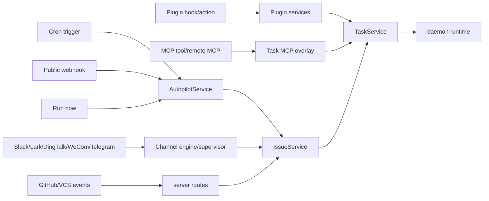
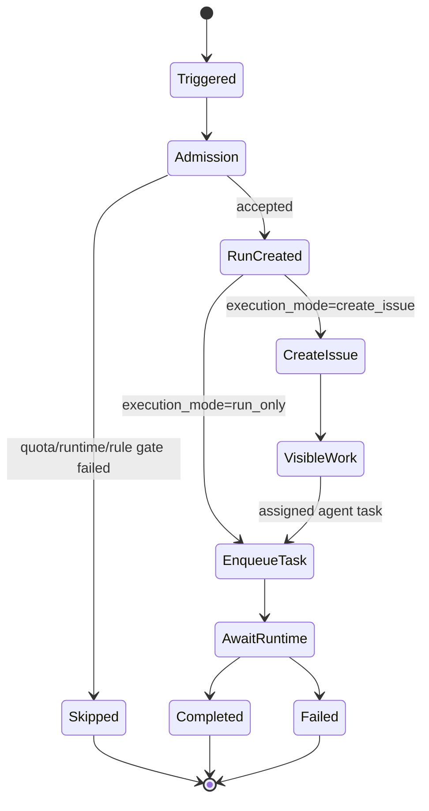
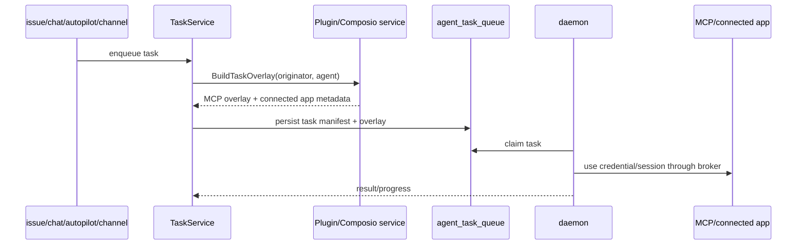

# Automation / Integrations：为什么扩展面最终都回到 issue/task 模型

先给结论：**Autopilot、plugin、channel、VCS、MCP 不是外围小功能，它们是把外部事件、定时规则和工具能力接进 Multica 核心 issue/task 执行链路的扩展骨架。**

如果只看 Web 页面，很容易把这些能力理解成“设置页里的集成”。但从 server 装配和 service 代码看，它们实际承担的是多入口、多协议、多自动化来源的统一调度。

## 扩展入口总图

关键点：这些入口不会各自维护一套“自动化结果”。它们最终都应该落到 issue、comment、agent task、autopilot run、plugin invocation 等 server truth 上。

## Autopilot 是自动化调度核心

`server/internal/service/autopilot.go` 的 `DispatchAutopilot` 是核心入口。注释说明它会创建 run，并根据 `execution_mode` 决定：

- `create_issue`：创建可见 issue，保留 durable audit trail；即使 runtime 暂时 offline，也可以先把工作放进系统，等 runtime 回来 claim。
- `run_only`：直接 enqueue agent task；触发前会做 runtime admission check，避免 paused laptop/offline daemon 让队列堆满 doomed tasks。

它还有多个入口：scheduled/webhook/api/manual。manual 会把 actorUserID 作为 accountability-bearing human action；webhook delivery 则先 admission，后续由 DB-backed worker 做 recoverable dispatch。

## Channel supervisor 把外部消息变成工作区动作

`server/cmd/server/router.go` 不只注册普通 HTTP route，还构造 channel engine，并把 Slack、Lark、DingTalk、WeCom、Telegram 等平台的 factory/resolver 注册进去，再交给 `ChannelSupervisor` 常驻驱动。也就是说 channel 不是“几个 webhook handler”，而是一层可插拔的运行面。

这层通常会碰到复杂边界：

- 外部群/用户绑定到 workspace/member。
- 外部消息创建 issue/comment。
- detached media 需要先解析附件，再 promote deferred assigned-agent task。
- 通知和回执要和 inbox/activity/comment 状态保持一致。

## Plugin / MCP 是任务执行能力扩展

`server/internal/service/task.go` 里 `ComposioOverlayBuilder` 的注释说明：每个 enqueue path 会根据当前用户 connected apps 和 agent allowlist，计算 per-task MCP overlay，并写入 `agent_task_queue.runtime_mcp_overlay`。这意味着 plugin/MCP 不是运行时临时拼接，而是在任务入队时就成为执行 manifest 的一部分。

Plugin 相关 service 和 migration 也显示出三个方向：

- hook/action：外部或内部事件触发 plugin 逻辑。
- invocation：记录可运营、可 TTL 清理的 plugin 调用状态。
- credential/token/MCP transport：让 daemon 在执行任务时安全取得必要工具能力。

## 为什么这块是关键系统而不是附属功能

1. **入口多**：cron、webhook、manual、chat、channel、VCS、plugin 都可能触发同一类 work。
2. **结果必须可审计**：autopilot run、rule version、webhook delivery、plugin invocation 都是为了事后解释“为什么它跑了”。
3. **执行仍由 runtime 完成**：扩展面通常只决定“要做什么”和“带哪些能力”，真正执行仍落到 daemon runtime。
4. **权限和 attribution 很容易错**：manual、人类 rule owner、automation principal、agent owner、connected app credential 都需要明确来源。

## 改动检查清单

- 新入口是否最终落到 `IssueService` 或 `TaskService`，而不是复制一套流程。
- 是否有 idempotency key 或 delivery/run 记录，避免 webhook/retry 重复执行。
- 是否记录了足够的 attribution 和 audit 信息。
- runtime offline 时，是应该 skipped，还是创建 visible work 等 runtime 回来。
- plugin/MCP credential 是否只在任务授权范围内解析。
- 事件是否能驱动前端 cache 和通知收敛。

Multica 的自动化价值来自“外部世界能可靠地把工作送进同一个协作执行系统”。因此扩展面越多，越要坚持回到 issue/task/runtime 这条主干。
