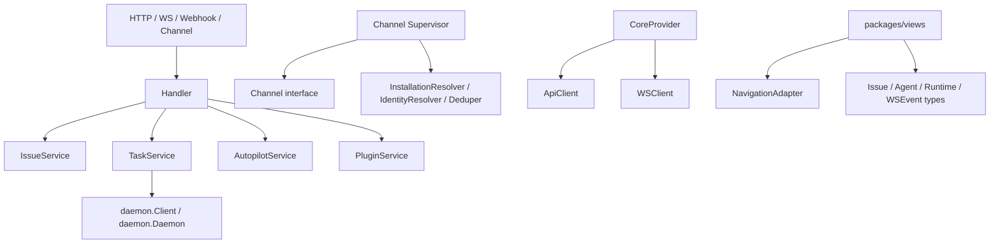
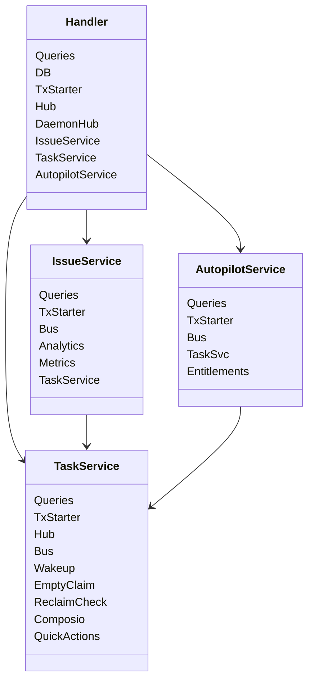
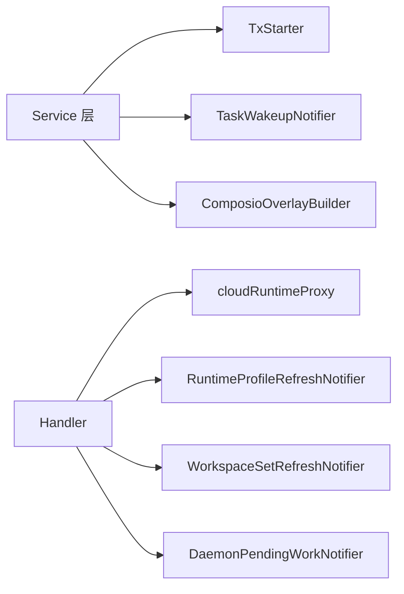
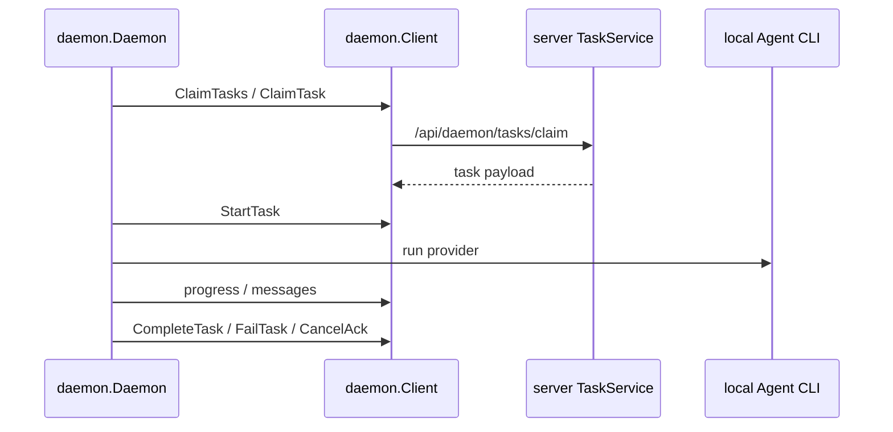
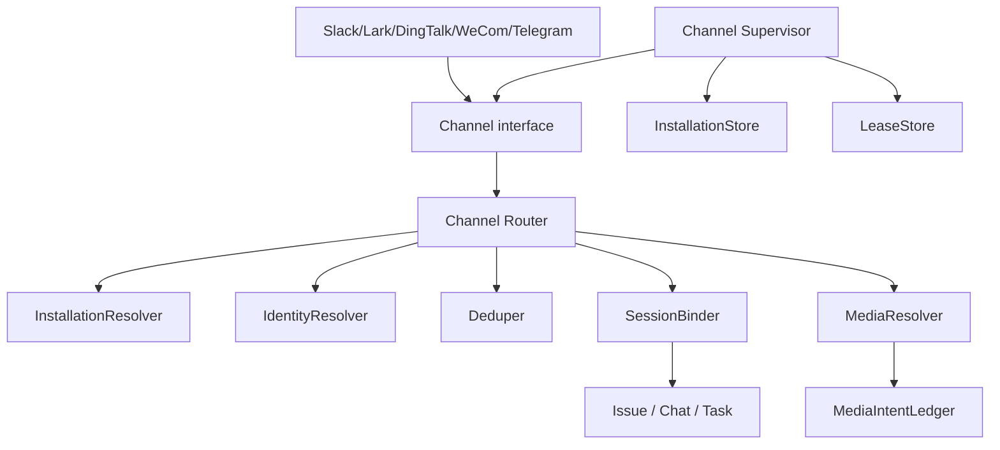
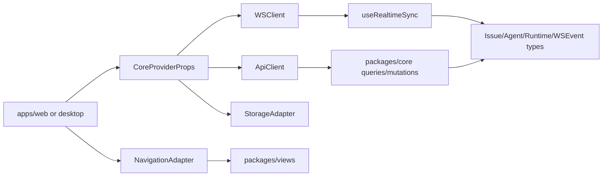
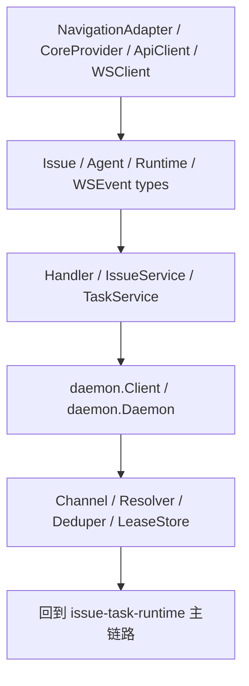

# 接口与关键结构体：从契约入口读 Multica

如果从“接口/结构体”入手，Multica 可以按四层契约理解：**后端 service 契约、daemon 执行契约、channel/integration 契约、前端 shared package 契约。** 这些契约比页面或单个 handler 更稳定，适合用来理清系统边界。

## 一、后端 service 层的关键结构体

| 结构体 / 接口 | 文件 | 它是什么契约 | 为什么关键 |
| --- | --- | --- | --- |
| `Handler` | `server/internal/handler/handler.go` | HTTP/API 层总装对象，持有 DB、Hub、DaemonHub、各 service、配置和通知器 | 这是外部请求进入 service 层的主要聚合点 |
| `handler.Config` | `server/internal/handler/handler.go` | server runtime 配置：注册、VCS、自托管 URL、代理、LLM、附件、plugin surface 等 | 很多产品能力是否启用由它决定 |
| `IssueService` | `server/internal/service/issue.go` | 创建 issue 的 service 入口 | 统一 HTTP、channel、未来入口的 issue 创建规则 |
| `IssueCreateParams` | `server/internal/service/issue.go` | 创建 issue 的 transport-agnostic 参数 | workspace、parent、project、assignee、origin、labels、stage 都在这里收束 |
| `IssueCreateOpts` | `server/internal/service/issue.go` | 创建 issue 的可选行为 knobs | 控制广播 payload、actor、analytics platform、deferred agent task |
| `IssueCreateResult` | `server/internal/service/issue.go` | 创建 issue 的 typed return | 带回 issue、attachments、assigned task、labels、duplicate conflict |
| `TaskService` | `server/internal/service/task.go` | agent task 队列、claim、start、complete/fail/cancel 的中枢 | 它连接 issue、runtime、daemon、event bus、MCP overlay 和 metrics |
| `AutopilotService` | `server/internal/service/autopilot.go` | 自动化规则调度和 run 记录入口 | cron/webhook/manual/api 最终通过它创建 issue 或 enqueue task |
| `PluginService` | `server/internal/service/plugin.go` | plugin 安装、包、hook/action/token 等扩展能力入口 | plugin/MCP 工具能力最终影响 task 执行环境 |

### service 依赖关系

## 二、后端接口 seam：哪些地方值得从 interface 看起

| 接口 | 文件 | 方法/责任 | 读它能理解什么 |
| --- | --- | --- | --- |
| `TxStarter` / `txStarter` | `server/internal/service/autopilot.go`、`server/internal/handler/handler.go` | `Begin(ctx)` | service 如何保持 transport-agnostic transaction 边界 |
| `dbExecutor` | `server/internal/handler/handler.go` | `Exec` / `Query` / `QueryRow` | handler 对 DB 的最小需求 |
| `TaskWakeupNotifier` | `server/internal/service/task.go` | `NotifyTaskAvailable(runtimeID, taskID)` | server 如何提醒 daemon 有新任务 |
| `ComposioOverlayBuilder` | `server/internal/service/task.go` | `BuildTaskOverlay(originator, agent)` | task enqueue 时如何注入 per-task MCP overlay |
| `cloudRuntimeProxy` | `server/internal/handler/handler.go` | `Enabled` / `Do` | SaaS-only cloud runtime 和自托管边界 |
| `RuntimeProfileRefreshNotifier` | `server/internal/handler/handler.go` | `NotifyRuntimeProfilesChanged` | runtime profile 变更如何推给 daemon |
| `WorkspaceSetRefreshNotifier` | `server/internal/handler/handler.go` | `NotifyWorkspacesChanged` | workspace membership 变化如何推给 daemon/account |
| `DaemonPendingWorkNotifier` | `server/internal/handler/handler.go` | `NotifyPendingWork` | model list/local skill 等 pending work 如何触发 daemon 快速 heartbeat |

## 三、daemon 执行面的关键结构体

| 结构体 / 接口 | 文件 | 契约意义 |
| --- | --- | --- |
| `daemon.Client` | `server/internal/daemon/client.go` | daemon 调 server 控制面的 HTTP client，包含 claim/start/progress/complete/resolve skill/MCP credential 等方法 |
| `daemon.Daemon` | `server/internal/daemon/daemon.go` | 本机 daemon 长生命周期对象，持有 runtime 状态、claim barrier、WS RPC、auto-update、GC、active task 等 |
| `taskRunner` | `server/internal/daemon/daemon.go` | provider 执行抽象，daemon 用它启动本机 agent CLI |
| `terminalTaskReport` | `server/internal/daemon/daemon.go` | task 终态回报的聚合数据 |
| `workspaceState` | `server/internal/daemon/daemon.go` | daemon 看到的 workspace/runtimes 本地状态 |
| `TaskCancelAck` | `server/internal/daemon/client.go` | cancel ack payload，报告 cancelled worktree branch / durable workdir 等结果 |
| `Config` / `Overrides` | `server/internal/daemon/config.go` | daemon profile 与运行时覆盖项 |
| `execenv.PrepareParams` | `server/internal/daemon/execenv/execenv.go` | 为 agent CLI 准备本地执行环境的输入 |
| `execenv.LocalWorktree` | `server/internal/daemon/execenv/local_worktree.go` | local worktree 生命周期结果 |

### daemon 控制面主方法

`daemon.Client` 里最值得先看的方法族：

- `ClaimTask` / `ClaimTasks`：claim 任务，batch claim 有短 timeout 和 legacy fallback。
- `StartTask`：任务进入 running。
- `MarkTaskWaitingLocalDirectory`：本地目录资源互斥时把任务停在 waiting state。
- `ResolveSkillBundle`：按 skill ref 下载 skill bundle。
- `ResolveRemoteMCPCredential`：按 task/contribution 获取 remote/plugin MCP credential。
- cancel/complete/fail 相关方法：把本机执行结果回写 server。

## 四、channel / integration 层接口

| 接口 / 结构体 | 文件 | 契约意义 |
| --- | --- | --- |
| `channel.Channel` | `server/internal/integrations/channel/channel.go` | 平台无关 IM channel：`Type`、`Connect`、`Disconnect`、`Send`、`Capabilities` |
| `channel.Config` | `server/internal/integrations/channel/channel.go` | per-installation config，Raw 保存平台私有配置，Handler 注入 inbound handler |
| `channel.Factory` | `server/internal/integrations/channel/channel.go` | 从 config 构造具体平台 channel |
| `InstallationResolver` | `server/internal/integrations/channel/engine/resolvers.go` | inbound message 找到 channel installation |
| `IdentityResolver` | `server/internal/integrations/channel/engine/resolvers.go` | external sender 映射到 Multica user/member |
| `Deduper` | `server/internal/integrations/channel/engine/resolvers.go` | 两阶段 idempotency seam：Claim/Mark/Release |
| `SessionBinder` | `server/internal/integrations/channel/engine/resolvers.go` | 确保 chat session、append message、bind media |
| `MediaResolver` | `server/internal/integrations/channel/engine/resolvers.go` | 平台媒体下载并上传到对象存储 |
| `MediaIntentLedger` | `server/internal/integrations/channel/engine/resolvers.go` | side effect 前先写 intent ledger，避免不确定提交 |
| `InstallationStore` | `server/internal/integrations/channel/engine/supervisor.go` | 列出所有 active channel installations |
| `LeaseStore` | `server/internal/integrations/channel/engine/supervisor.go` | 多副本下的 token-fenced WS lease |

这组接口的重点是：**platform SDK 和 wire format 被限制在 adapter 内，核心只吃 normalized message 和 resolver 结果。**

## 五、前端 shared package 的关键接口 / 类型

| 接口 / 类型 | 文件 | 契约意义 |
| --- | --- | --- |
| `CoreProviderProps` / `ClientIdentity` | `packages/core/platform/types.ts` | app 把 api/ws/storage/locale/platform identity 注入 shared core |
| `StorageAdapter` | `packages/core/types/storage.ts` | core 不碰 `localStorage`，由平台传 storage 实现 |
| `ApiClient` / `ApiClientOptions` / `ApiClientIdentity` | `packages/core/api/client.ts` | 前端 API client 契约和 client identity header/source |
| `WSClient` / `WSClientIdentity` | `packages/core/api/ws-client.ts` | WebSocket client，处理 token/cookie auth、reconnect、event dispatch |
| `NavigationAdapter` | `packages/views/navigation/types.ts` | shared views 的路由能力抽象，Web 接 Next，Desktop 接 tab/router |
| `Issue` / `IssueStatus` / `IssueStatusCategory` | `packages/core/types/issue.ts` | issue UI/server contract；status key open，category closed |
| `Agent` / `AgentRuntime` / `RuntimeProfile` | `packages/core/types/agent.ts` | agent 和 runtime 的 client contract |
| `WSEventType` / `WSEventPayloadMap` / `WSMessage` | `packages/core/types/events.ts` | realtime event protocol 的 TS 投影 |
| `AuthState` | `packages/core/auth/store.ts` | auth Zustand store shape |
| `ChatState` | `packages/core/chat/store.ts` | chat draft/pending/timeline client state |

### 前端契约如何协作

## 六、建议阅读顺序

如果你想从“接口”开始理清楚，我建议这样读：

1. **前端入口契约**：`NavigationAdapter`、`CoreProviderProps`、`ApiClient`、`WSClient`。先理解 Web/Desktop 如何共享页面。
2. **核心域类型**：`Issue`、`AgentRuntime`、`RuntimeProfile`、`WSEventType`。先知道前端认为 server 会返回什么。
3. **后端 service struct**：`Handler`、`IssueService`、`TaskService`、`AutopilotService`。理解请求进入后会落到哪里。
4. **daemon 契约**：`daemon.Client`、`daemon.Daemon`、`taskRunner`。理解 task 如何真正跑到本机。
5. **integration seam**：`Channel`、resolvers、deduper、lease store。理解外部平台如何进入统一 issue/chat/task 模型。

