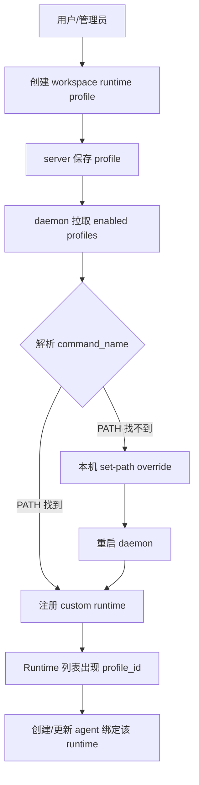
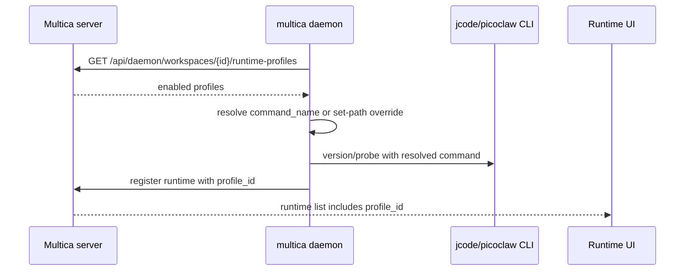

# 自定义 Runtime Profile：让 jcode / picoclaw 这类本机 CLI 接入 Multica

先给结论：**如果一个本机 CLI 已经兼容 Multica 支持的某个协议家族，就不需要先把它做成内置 runtime。先创建 workspace 级 custom runtime profile，让 daemon 按 profile 注册 runtime，是风险最低的接入方式。**

这篇文档把当前源码里的可用路径整理成操作说明。主要证据来自：

- `server/cmd/multica/cmd_runtime_profile.go`
- `server/internal/daemon/client.go` 的 `RuntimeProfile`
- `server/internal/daemon/config.go` 的 `ProfileCommandOverrides`
- `server/pkg/agent/agent.go` 的 `SupportedTypes`
- `packages/core/types/agent.ts` 的 `RUNTIME_PROFILE_PROTOCOL_FAMILIES`

## 一张流程图



## 核心概念

Custom runtime profile 有两层配置：

| 层级 | 保存位置 | 字段/命令 | 作用 |
| --- | --- | --- | --- |
| Workspace profile | server | `display_name`、`protocol_family`、`command_name`、`description`、`fixed_args`、`enabled` | 定义这个 workspace 允许哪类自定义 runtime |
| Per-machine path override | 本机 CLI config | `multica runtime profile set-path <profile-id> --path ...` | 某台机器上指定 profile 的实际可执行文件路径 |

关键区别：profile 是团队共享的 workspace 配置；`set-path` 只在当前机器生效，不会上传 server。

## 1. 创建 jcode runtime profile

jcode 当前应走 `hermes` 协议家族。创建命令：

```bash
multica runtime profile create \
  --display-name "Jcode" \
  --protocol-family hermes \
  --command-name jcode \
  --description "Jcode custom runtime"
```

返回 JSON 或表格里会有 `id`，记作 `<profile-id>`。

如果 daemon 启动环境能直接找到 `jcode`，不需要额外配置。先确认：

```bash
jcode --version
```

如果 `jcode` 在你的交互 shell 能找到，但 GUI/launchctl 启动的 daemon 找不到，或你想固定某个安装路径，用：

```bash
multica runtime profile set-path <profile-id> --path "$(which jcode)"
multica daemon restart
```

`set-path` 要求绝对路径。源码里也明确会打印“Restart the daemon for the change to take effect.”，所以设置后需要重启 daemon。

## 2. 创建 picoclaw runtime profile

如果 picoclaw 兼容 OpenClaw 协议，建议：

```bash
multica runtime profile create \
  --display-name "Picoclaw" \
  --protocol-family openclaw \
  --command-name picoclaw \
  --description "Picoclaw custom runtime"
```

需要固定本机路径时：

```bash
multica runtime profile set-path <profile-id> --path "$(which picoclaw)"
multica daemon restart
```

如果 picoclaw 不是 OpenClaw 兼容协议，就不能只靠 profile 接入。那需要新增后端 backend、协议 family、migration、前端白名单和 daemon probe，属于“新增协议家族”而不是 custom profile 配置。

## 3. 查看和维护 profile

列出当前 workspace 的 profiles：

```bash
multica runtime profile list
```

JSON 输出方便拿 ID：

```bash
multica runtime profile list --output json
```

更新 display name / command / description / enabled：

```bash
multica runtime profile update <profile-id> \
  --display-name "Jcode" \
  --command-name jcode \
  --description "Jcode custom runtime" \
  --enabled true
```

删除 profile：

```bash
multica runtime profile delete <profile-id>
```

删除可能因为仍有 active agents 绑定而返回 409。CLI 会把 server 的解释透出，按提示先解绑或归档相关 agent。

取消本机路径 override：

```bash
multica runtime profile unset-path <profile-id>
multica daemon restart
```

## 4. CLI 目前的 fixed_args 限制

`multica runtime profile create` 当前只暴露：

- `--protocol-family`
- `--command-name`
- `--display-name`
- `--description`
- `--output`

源码里明确注释：`--fixed-arg` 暂时不在 CLI create/update surface，因为产品路径在 UI 中解析 command + args 后存为 `command_name + fixed_args`。

所以：

- 如果 runtime 只需要一个命令，比如 `jcode` 或 `picoclaw`，CLI 足够。
- 如果 runtime 需要 `picoclaw agent stdio` 这类固定子命令，优先用 Web UI 的 runtime profile 创建路径。
- 或者后续给 CLI 补 `--fixed-arg` 支持，再把固定参数写入 API body。


## 5. daemon 发现和注册时会发生什么

daemon 的 custom profile 路径和 built-in probe 路径是分开的：

- built-in runtime 来自 `probeAgentCLIs()`，扫内置 provider 的 CLI。
- custom profile 来自 workspace 的 enabled runtime profiles。
- profile 里的 `protocol_family` 决定使用哪个 backend。
- profile 里的 `command_name` 或本机 `set-path` 决定实际 executable。
- 注册出来的 runtime 会带 `profile_id`，前端也用这个字段区分 custom runtime。



## 6. 排查清单

如果 profile 建好了但 runtime 没出现，按这个顺序查：

1. 当前 workspace 是否正确：

   ```bash
   multica runtime profile list --output json
   ```

2. 本机是否能找到命令：

   ```bash
   which jcode
   jcode --version
   ```

   或：

   ```bash
   which picoclaw
   picoclaw --version
   ```

3. 如果 daemon 找不到但 shell 找得到，设置本机 override：

   ```bash
   multica runtime profile set-path <profile-id> --path "$(which jcode)"
   multica daemon restart
   ```

4. 如果仍然没有出现，看 daemon 日志：

   ```bash
   multica daemon logs
   ```

5. 确认协议 family 正确：

   - jcode：`hermes`
   - picoclaw：只有在兼容 OpenClaw 时才用 `openclaw`

## 7. 什么时候要做成内置自动发现

等 custom runtime profile 跑稳定后，再考虑内置自动发现。判断标准：

- 这个 CLI 是通用 runtime，不只是某个 workspace 的 wrapper。
- 它无需用户手动创建 profile，也应该被 daemon 周期性发现。
- 它复用已有 backend，或你愿意新增完整 backend。
- 它的 command name 需要加入 login-shell fallback guard。

内置自动发现要改：

- `server/internal/daemon/agents_probe.go`
- `server/pkg/agent/builtin_runtimes.go`，如果是已有协议的兼容 fork
- `scripts/agent-cli-command-names.txt`
- 以及可能的 backend override applicator / display / frontend 映射

但对 jcode 和 picoclaw 的第一步，不需要先走这条重路径。custom runtime profile 已经能验证协议兼容性和真实执行体验。
