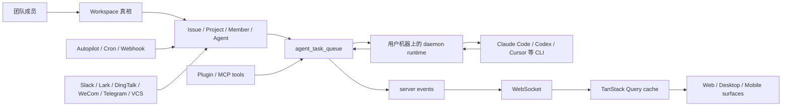

# Multica 关键系统专题索引

这组文档回答一个更偏工程判断的问题：**Multica 最关键的内容到底是哪几块，为什么它们比页面细节更应该先读？**

我的判断是，Multica 的关键性不在单个功能点，而在五条主链路能否稳定闭环：工作区域模型、issue 到 agent 的执行流、实时缓存同步、多端共享前端架构、以及自动化和集成扩展面。现有 `ai-docs/multica-system-surfaces-and-execution-model*` 已经覆盖系统上下文、后端常驻模型、CLI/daemon、部署和数据演进；本组文档在此基础上补“读代码时最容易误判、但最能决定改动成败”的专题。

## 建议阅读顺序

| 文档 | 先解决的问题 | 关键代码范围 |
| --- | --- | --- |
| `01-critical-map.md` | 哪几块是 Multica 的关键复杂度中心 | `CLAUDE.md`、`server/`、`packages/*`、`apps/*` |
| `02-workspace-domain-model.md` | 为什么所有业务都必须先过 workspace 边界 | `packages/core/types/*`、`packages/core/workspace/*`、`apps/web/app/[workspaceSlug]/layout.tsx`、`server/internal/service/*` |
| `03-issue-agent-runtime-flow.md` | 从创建 issue 到 agent 在本机执行，中间发生什么 | `server/internal/service/issue.go`、`task.go`、`server/internal/daemon/*`、`server/cmd/server/router.go` |
| `04-realtime-query-cache-sync.md` | 为什么前端缓存同步是核心架构，而不是 UI 细节 | `packages/core/query-client.ts`、`packages/core/realtime/*`、`packages/core/*/queries.ts`、`packages/core/*/ws-updaters.ts` |
| `05-shared-frontend-platform.md` | Web/Desktop 如何共享业务页面但隔离平台能力 | `packages/core/platform/*`、`packages/views/navigation/*`、`apps/web/platform/*`、`apps/desktop/src/renderer/src/*` |
| `06-automation-integrations.md` | Autopilot、plugin、channel 为什么是平台扩展骨架 | `server/internal/service/autopilot.go`、`plugin*.go`、`server/cmd/server/router.go`、`server/migrations/*` |

## 一张总图

这张图里的关键点是：**server 保存真相，daemon 执行任务，实时事件驱动各端缓存收敛。** 如果改动破坏了任何一段，用户看到的就不只是某个按钮坏了，而是“派活、执行、回报、刷新”的核心闭环断掉。

## 和已有 ai-docs 的关系

- 已有文档偏“系统运行面和演进证据”。
- 本组文档偏“改代码前应该建立的关键心智模型”。
- 两者互补：先读已有架构总览，再读本组专题，可以更快定位你要改的是协调层、执行层、实时同步层，还是平台适配层。
